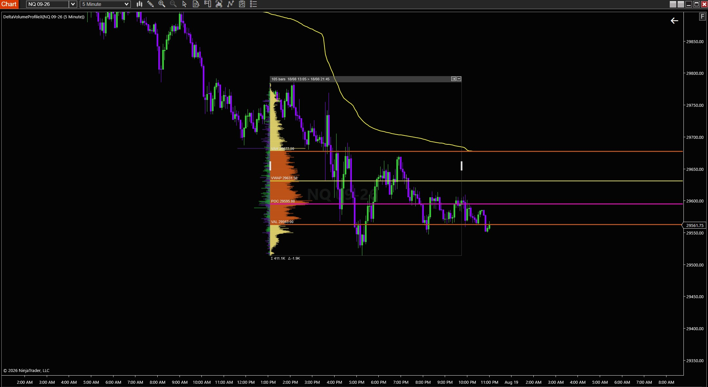
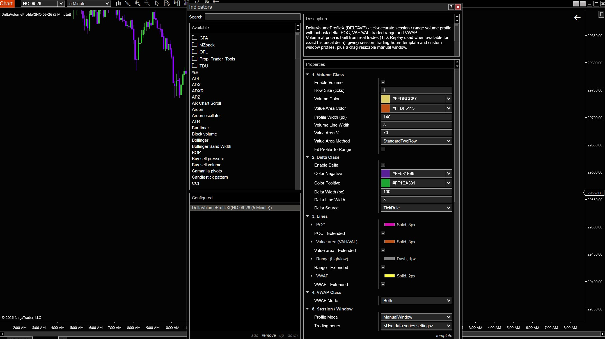

# DeltaVolumeProfileX (DELTAVP)

**Free tick-accurate Volume Profile with bid-ask Delta for NinjaTrader 8**
**مؤشر بروفايل حجم مجاني ودقيق على مستوى التِك مع دلتا العرض والطلب لمنصة NinjaTrader 8**

POC · Value Area (VAH/VAL) · Traded Range · VWAP · Session, Template & Manual-Window profiles

[**English**](#english) · [**العربية**](#arabic)

[**Download**](dist/DeltaVolumeProfileX.dll) · [Install & Usage](INSTALL_AND_USAGE.md) · [Official page (EN)](https://mohamed-abdelaziz.com/en/learning/tools/delta-volume-profile-x) · [الصفحة الرسمية (AR)](https://mohamed-abdelaziz.com/ar/learning/tools/delta-volume-profile-x) · [License](LICENSE.txt)

---

## Overview

**DeltaVolumeProfileX** is a **free Volume Profile indicator for NinjaTrader 8** that shows *where volume actually traded* — not where price simply spent time. Volume-at-price is built from **real trades** (Tick Replay used when available for exact historical **bid-ask delta**), so every profile reflects the real auction: the **Point of Control (POC)**, the **Value Area (VAH/VAL)**, the **traded range** high/low, and **VWAP**.

It is designed for **order-flow** and volume-based traders who read market structure through volume-at-price — on futures such as **NQ, ES and Gold**, as well as other instruments.

## Features

- **Tick-accurate** volume-at-price from real trades — never bar volume.
- **True bid-ask delta**, exact historically when Tick Replay is enabled; tick-rule fallback otherwise.
- **POC / Value Area / Range / VWAP** levels — each independently coloured, styled, extended.
- **Three profiling modes:** automatic session profiles, a Trading-Hours **template**, or a custom time window.
- **Interactive manual window** — drag to move, drag the edges to resize, optional anchor-to-last-bar.
- **Row Size (ticks)** to match the resolution of any profile you compare against.
- Works on **time, Renko, Range, Tick and Volume** bars (Tick Replay recommended for non-time bars).
- Built for real-time: O(1) per trade on the hot path, snapshot-based rendering, flat memory.

## Install

1. Close NinjaTrader.
2. Download [`dist/DeltaVolumeProfileX.dll`](dist/DeltaVolumeProfileX.dll) and copy it into:
`Documents\NinjaTrader 8\bin\Custom\`
3. Start NinjaTrader → on a chart: **Indicators → DeltaVolumeProfileX → Add**.

Full steps and recommended settings: **[INSTALL_AND_USAGE.md](INSTALL_AND_USAGE.md)**.

> Enable **Tick Replay** on the chart's Data Series for exact historical delta and precise
> attribution on Renko/Range/Tick bars.

## Compatibility

| | |
|---|---|
| Platform | NinjaTrader 8 (8.1.x) |
| Instruments | Any (futures, stocks, forex, crypto CFDs) — tuned for NQ / ES / Gold |
| Data | Tick Replay recommended; works without it using the tick rule |

## FAQ

**Does it require Tick Replay?**
No. Tick Replay is recommended for exact historical delta and for Renko/Range/Tick bars; without it the indicator uses the tick rule.

**Which bar types are supported?**
Time, Renko, Range, Tick and Volume bars.

**Which NinjaTrader version?**
NinjaTrader 8 (8.1.x).

## More tools by Mohamed Abdelaziz

- [DeltaVolumeProfileX — official page](https://mohamed-abdelaziz.com/en/learning/tools/delta-volume-profile-x)
- [MA ICT Killzones & Pivots](https://mohamed-abdelaziz.com/en/learning/tools/ma-ict-killzones-pivots) — session killzones, pivots and a Session Volume Profile (POC, VAH, VAL)
- [All trading tools](https://mohamed-abdelaziz.com/en/learning/tools)

## License

**Free to download and use.** The indicator remains the property of Mohamed Abdelaziz — **selling it or using it commercially is prohibited without written permission.** Copying, modification, reverse engineering, redistribution or sub-licensing also require written permission. See [LICENSE.txt](LICENSE.txt).

This indicator is an **analytical tool only** — it is not financial advice and does not guarantee
any result. Trading futures involves substantial risk.

---

## نظرة عامة

**DeltaVolumeProfileX** هو **مؤشر بروفايل حجم (Volume Profile) مجاني لمنصة NinjaTrader 8** يوضح *أين تم تداول الحجم فعلاً* — وليس فقط أين قضى السعر وقته. يُبنى الحجم عند كل سعر من **الصفقات الحقيقية** (مع استخدام Tick Replay عند توفره للحصول على **دلتا العرض والطلب** التاريخية بدقة)، لذلك يعكس كل بروفايل المزاد الحقيقي: **نقطة التحكم (POC)**، و**منطقة القيمة (VAH/VAL)**، و**أعلى وأدنى المدى المتداول**، و**VWAP**.

صُمم المؤشر لمتداولي **الأوردر فلو (Order Flow)** والتحليل المعتمد على الحجم الذين يقرؤون هيكل السوق من خلال الحجم عند السعر — على العقود الآجلة مثل **NQ وES والذهب**، وعلى أدوات أخرى أيضاً.

## المميزات

- حجم عند السعر **دقيق على مستوى التِك** من الصفقات الحقيقية — وليس من حجم الشموع.
- **دلتا حقيقية للعرض والطلب**، دقيقة تاريخياً عند تفعيل Tick Replay، مع الاعتماد على قاعدة التِك (Tick Rule) في غير ذلك.
- مستويات **POC ومنطقة القيمة والمدى وVWAP** — لكل منها لون ونمط وامتداد مستقل.
- **ثلاثة أوضاع للبروفايل:** بروفايلات الجلسات تلقائياً، أو **قالب** ساعات التداول (Trading Hours)، أو نافذة زمنية مخصصة.
- **نافذة يدوية تفاعلية** — اسحب لتحريكها، واسحب الحواف لتغيير حجمها، مع خيار تثبيتها على آخر شمعة.
- إعداد **Row Size (بالتِك)** لمطابقة دقة أي بروفايل آخر تقارن به.
- يعمل على شموع **الوقت وRenko وRange وTick وVolume** (يُنصح بـ Tick Replay للشموع غير الزمنية).
- مصمم للعمل اللحظي: معالجة O(1) لكل صفقة، ورسم قائم على اللقطات (Snapshots)، واستهلاك ذاكرة ثابت.

## التثبيت

1. أغلق NinjaTrader.
2. حمّل الملف [`dist/DeltaVolumeProfileX.dll`](dist/DeltaVolumeProfileX.dll) وانسخه إلى المجلد:
`Documents\NinjaTrader 8\bin\Custom\`
3. شغّل NinjaTrader ← من الشارت: **Indicators ← DeltaVolumeProfileX ← Add**.

الخطوات الكاملة والإعدادات الموصى بها في ملف **[INSTALL_AND_USAGE.md](INSTALL_AND_USAGE.md)**.

> فعّل **Tick Replay** في Data Series الخاصة بالشارت للحصول على دلتا تاريخية دقيقة وتوزيع صحيح للحجم على شموع Renko وRange وTick.

## التوافق

| | |
|---|---|
| المنصة | NinjaTrader 8 (8.1.x) |
| الأدوات | أي أداة (عقود آجلة، أسهم، فوركس، عقود فروقات العملات الرقمية) — مضبوط لـ NQ وES والذهب |
| البيانات | يُنصح بـ Tick Replay، ويعمل بدونه باستخدام قاعدة التِك |

## أسئلة شائعة

**هل يحتاج المؤشر إلى Tick Replay؟**
لا. يُنصح به للحصول على دلتا تاريخية دقيقة ولشموع Renko وRange وTick، وبدونه يستخدم المؤشر قاعدة التِك.

**ما أنواع الشموع المدعومة؟**
شموع الوقت وRenko وRange وTick وVolume.

**ما إصدار NinjaTrader المطلوب؟**
NinjaTrader 8 (8.1.x).

## أدوات أخرى من محمد عبد العزيز

- [الصفحة الرسمية لمؤشر DeltaVolumeProfileX](https://mohamed-abdelaziz.com/ar/learning/tools/delta-volume-profile-x)
- [MA ICT Killzones & Pivots](https://mohamed-abdelaziz.com/ar/learning/tools/ma-ict-killzones-pivots) — مناطق القتل (Killzones) للجلسات والبيفوتات وبروفايل حجم الجلسة (POC وVAH وVAL)
- [جميع أدوات التداول](https://mohamed-abdelaziz.com/ar/learning/tools)

## الترخيص

**المؤشر مجاني للتحميل والاستخدام.** ويبقى ملكاً لمحمد عبد العزيز — **يُمنع بيعه أو استخدامه بشكل تجاري دون إذن كتابي.** كما يُمنع النسخ أو التعديل أو الهندسة العكسية أو إعادة التوزيع أو الترخيص من الباطن دون إذن كتابي. راجع [LICENSE.txt](LICENSE.txt).

هذا المؤشر **أداة تحليلية فقط** — وليس نصيحة مالية ولا يضمن أي نتيجة. تداول العقود الآجلة ينطوي على مخاطر كبيرة.

---

**© 2026 Mohamed Abdelaziz · محمد عبد العزيز**
[mohamed-abdelaziz.com](https://mohamed-abdelaziz.com/en) · [النسخة العربية من الموقع](https://mohamed-abdelaziz.com/ar)

